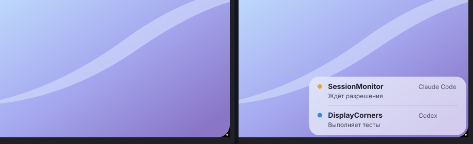

# Агентский угол

В первоначальном одобренном макете один и тот же нижний правый угол показан до и после наведения. Порядок строк на рисунке иллюстративный, при открытии порядок определяется временем обновления. Пока меню открыто, строки сохраняют положение, новые сессии добавляются сверху. Один шаг координат SVG соответствует одному логическому пункту macOS. В локальных координатах каждой панели границы дисплея сходятся в точке (447, 267), а границы меню — в (443, 263). Обе дуги имеют центр (423, 243). Эти размеры относятся к образцу агентского угла. Настройка радиуса обычных скруглений описана в [README приложения](../README.md).

Обновлённый внешний вид меню со значками Claude Code и Codex одобрен в [SwiftUI-прототипе](../prototypes/corner-preview/README.md). Ромб на исходном макете заменяется цветной точкой по решению пользователя.

## Сценарий приёмки

| Действие или событие | Что видит пользователь |
| --- | --- |
| Codex выполняет тесты в DisplayCorners. Claude Code запрашивает разрешение в SessionMonitor. | Внутри чёрной маски появляется янтарная точка. |
| Пользователь наводит указатель в область активации. | Точка остаётся на месте. В меню видны строки SessionMonitor с подписью «Ждёт разрешения» и DisplayCorners с подписью «Выполняет тесты». При открытии более свежее изменение находится ниже. Фокус остаётся в текущем приложении. |
| Пока указатель находится на строке, другая сессия обновляется или появляется новая. | Существующие строки не пересортировываются. Новая сессия вставляется сверху, при этом под указателем остаётся та же строка. |
| Пользователь переводит указатель в меню и нажимает первую строку. | Открывается ожидающая сессия Claude Code. Пользователь отвечает в ней. При выборе второй строки переход ведёт в сессию Codex. |
| Claude Code сообщает о возобновлении работы, других запросов нет. | Общий индикатор меняется на синий. При повторном наведении прежний запрос разрешения исчез из списка ожидающих. |
| Источники сообщают, что активных сессий больше нет. | Индикатор исчезает, скругление остаётся. |

Макет подтверждает внешний вид. Для проверки переходов понадобятся две различимые сессии и наблюдение за сменой фокуса и статусов. В текущем приложении [окна маски](../Sources/DisplayCorners/main.swift) пропускают события мыши. Проверка их геометрии сама по себе не проверяет наведение.

При установленных hooks слишком маленький выбранный радиус увеличивается до минимального достаточного для агентского угла; после удаления всех hooks снова используется выбор пользователя. Положение индикатора на физически скруглённом экране потребует отдельного решения. Кнопки быстрых действий, завершение и ошибки, доступность и приватность отложены. Абстрактный контракт источника описан в [протоколе адаптера](../specs/harness-adapter.md).
